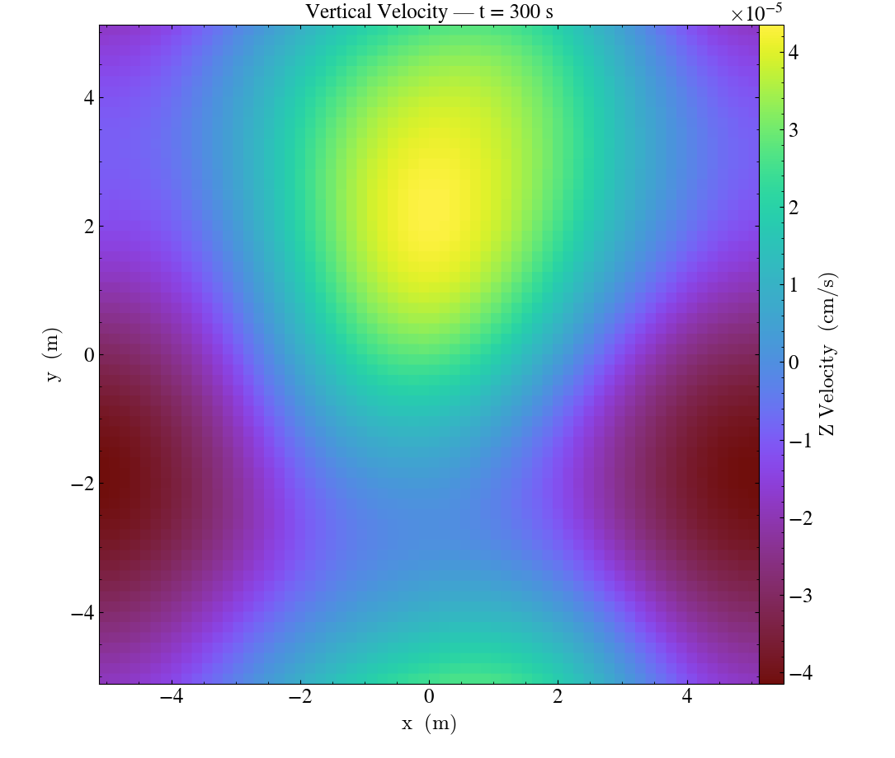

# ERF GPU Simulation on UC Berkeley Savio

This project demonstrates GPU-accelerated atmospheric modeling
using ERF, AMReX, CUDA, MPI, and NVIDIA A40 GPUs.

## GPU Configuration

| Component | Configuration |
|---|---|
| GPU | NVIDIA A40 |
| CUDA | 12.6 |
| Architecture | SM 86 |
| Compiler | GCC 13.2.0 |
| MPI | OpenMPI 4.1.6 |
| GPU Backend | AMReX CUDA |
| Precision | Double |

## Deardorff ABL Simulation

A three-dimensional atmospheric boundary layer simulation
was successfully completed on Savio.

| Metric | Result |
|---|---|
| Simulation steps | 4,000 |
| Simulated time | 400 seconds |
| Total runtime | 98.13 seconds |
| Grid cells per step | 262,144 |
| Exit code | 0 |

Tested ERF commit: b338cc077

These results were obtained with the tested commit, not
necessarily the newer ERF version in this repository.

## Build and Execution

Build configuration:

    bash savio/build_gpu.sh

SLURM submission:

    sbatch savio/run_deardorff.sh

The scripts require a compatible Savio MPI environment
and appropriate SLURM account configuration. They have
not yet been retested against the newer ERF revision.

## Simulation Visualization

## Future Work

- GPU-accelerated methane dispersion
- Landfill atmospheric transport modeling
- CPU versus GPU benchmarking

## Acknowledgments

Original ERF project: https://github.com/erf-model/ERF

AMReX: https://github.com/AMReX-Codes/amrex
